# 12 tested prompts for Qwen-Image 2.1

Every prompt comes with the image it made, the exact recipe, and one line on why it works.

Made by Kurt & Alia Holes.

Each entry: the finished image, the exact prompt that made it, the recipe read from the image's own generation graph, and one line on why the prompt works.

## 01. Visit the Moon

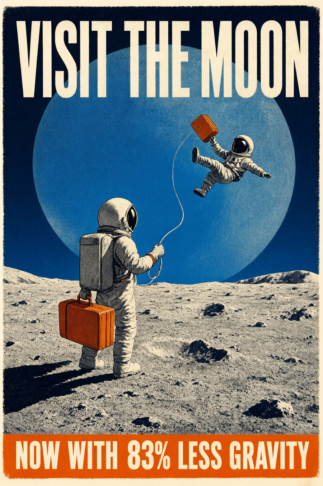

**Prompt**

```text
A vintage 1950s three-colour screenprint travel poster with coarse halftone grain, slight ink misregistration and worn cream paper. Large bold lettering across the top reads "VISIT THE MOON". Behind everything, the Earth is a huge blue disc filling the upper half of the sky. On the crater rim below, a parent in a round-helmeted spacesuit holds one orange suitcase and a thin tether; the tether rises to a small child floating a metre above the ground, also holding one orange suitcase, legs kicking with delight. Low, hard sunlight from the left throws long black shadows across the grey crater dust. Palette limited to deep navy, cream, grey and one orange accent on the two suitcases. At the bottom, a clean orange banner reads "NOW WITH 83% LESS GRAVITY". Exactly two astronauts, one suitcase each, one continuous horizon line.
```

**Recipe**

- **Model:** Qwen-Image 2.1
- **Steps:** 25
- **CFG:** 1
- **Sampler:** euler
- **Scheduler:** simple
- **Size:** 1344x2016
- **Seed:** 7011
- **Weights:** qwen_image_2.1_int8_convrot.safetensors
- **Text encoder:** qwen3vl_8b_int8_convrot.safetensors
- **VAE:** qwen_image_2.1_vae_bf16.safetensors

**Why it works:** The lettering is spelled out word for word, with a place for each line. The counts are stated too: exactly two astronauts, one suitcase each.

## 02. Death at the Self-Checkout

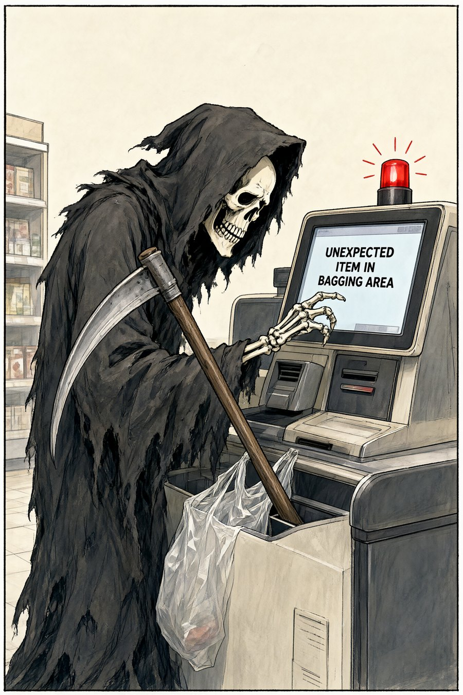

**Prompt**

```text
A single-panel gag cartoon in a Franco-Belgian ink-and-watercolor comic style, clean confident ink linework with muted watercolor washes. Inside a bright, ordinary supermarket, the Grim Reaper in a tattered black hooded robe stands at a self-checkout machine, bony shoulders slumped in defeat. His long scythe is jammed diagonally into the bagging area, poking out of a plastic shopping bag. The checkout screen glows and reads in clear bold letters: "UNEXPECTED ITEM IN BAGGING AREA". One skeletal hand hovers helplessly over the touchscreen. A small blinking red light tops the machine. Muted cream and grey palette with the Reaper as the darkest shape in the frame and the red light as the one accent. Plain background with a few shelves, lots of breathing room, the joke readable at a glance. No other text anywhere in the image.
```

**Recipe**

- **Model:** Qwen-Image 2.1
- **LoRA:** Qwen-Image-2.1-viggle-turbo-v0.2.1-6step-lora-r256.safetensors (strength 1)
- **Steps:** 6
- **CFG:** 1
- **Sampler:** euler
- **Scheduler:** manual sigmas
- **Sigmas:** 1, 0.976538, 0.951036, 0.892753, 0.735083, 0.480498, 0
- **Guider:** BasicGuider
- **Size:** 1344x2016
- **Seed:** 4102
- **Weights:** qwen_image_2.1_int8_convrot.safetensors
- **Text encoder:** qwen3vl_8b_int8_convrot.safetensors
- **VAE:** qwen_image_2.1_vae_bf16.safetensors

**Why it works:** The joke is written out in quotes on the screen, and "no other text anywhere" keeps it the only lettering in the frame.

## 03. The Sleeping Mountain

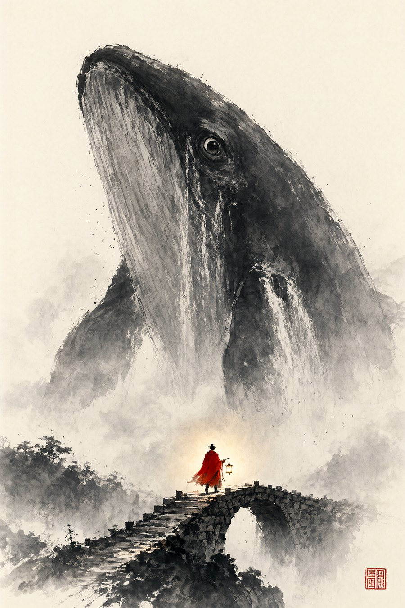

**Prompt**

```text
A traditional sumi-e ink painting on warm cream rice paper, made with crisp dry-brush strokes, visible paper fibres and a few controlled ink splatters. A colossal mountain in the shape of a whale rises from a sea of mist, its whole head in frame with a margin of blank paper around it, one great open eye as large as a temple gate looking down. Mist pours from its flanks like waterfalls. Far below, on the lower third, a tiny figure in a vivid vermilion cloak crosses a narrow stone bridge, carrying a lantern whose small warm halo tints the mist and the bridge stones around them. Everything is black ink, grey wash and paper white, except the red cloak. A small red seal stamp sits in the lower right corner. Enormous scale contrast and wide empty paper.
```

**Recipe**

- **Model:** Qwen-Image 2.1
- **Steps:** 25
- **CFG:** 1
- **Sampler:** euler
- **Scheduler:** simple
- **Size:** 1344x2016
- **Seed:** 7031
- **Weights:** qwen_image_2.1_int8_convrot.safetensors
- **Text encoder:** qwen3vl_8b_int8_convrot.safetensors
- **VAE:** qwen_image_2.1_vae_bf16.safetensors

**Why it works:** Medium first: sumi-e ink on cream rice paper. Only one colour is allowed, a vermilion cloak, so a tiny figure still holds its own under a whale the size of a mountain.

## 04. Fishing for the Moon

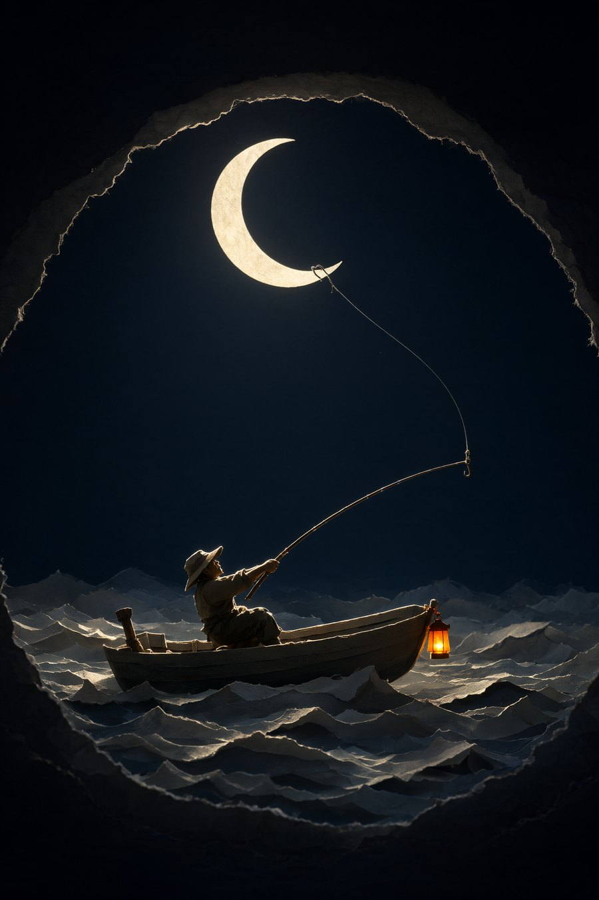

**Prompt**

```text
The image is a vertical photorealistic photograph of a layered cut-paper diorama at night, framed by a dark paper arch of wave crests, with torn fibrous paper edges and soft cast shadows between the layers. In the lower half, an old fisherman in a small rowboat leans far back with all his weight, his figure rim-lit by moonlight; his hat and shoulders glow with pale gold as the single taut fishing line runs unbroken from the tip of his rod, bent into a deep arc, up to a hook caught on the lower horn of a huge glowing crescent moon that fills the upper third of the sky. Moonlight spills pale gold across the paper waves and rim-lights the fisherman’s hat and shoulders. A small orange lantern hangs from the bow as the only warm accent. The sea and sky are deep navy fading to black, with wide empty sky around the moon. One rod, one line, one hook. The lighting is soft, diffused moonlight emanating from the crescent moon above, casting gentle highlights on the fisherman’s silhouette and the paper waves while leaving the surrounding sky in deep shadow. The overall composition feels serene, mythic, and quietly dramatic, anchored by the stark geometry of the paper layers and the luminous moon against the vast, dark sky.
```

**Recipe**

- **Model:** Qwen-Image 2.1
- **Steps:** 25
- **CFG:** 1
- **Sampler:** euler
- **Scheduler:** simple
- **Size:** 1344x2016
- **Seed:** 7051
- **Weights:** qwen_image_2.1_int8_convrot.safetensors
- **Text encoder:** qwen3vl_8b_int8_convrot.safetensors
- **VAE:** qwen_image_2.1_vae_bf16.safetensors

**Why it works:** The line is traced from the rod tip to the moon's lower horn, and the props are counted: one rod, one line, one hook. One idea, easy to read.

**Note:** This prompt was expanded before rendering by Qwen's official prompt-rewriter instructions, run on the model's own Qwen3-VL text encoder. The text above is exactly what the model encoded. The shorter prompt we wrote by hand, which went into the rewriter, is below.

**What went into the rewriter**

```text
A layered cut-paper diorama photographed at night, with torn fibrous paper edges and soft cast shadows between the layers. Framed by a dark paper arch of wave crests, an old fisherman in a small rowboat leans far back with all his weight. A single taut fishing line runs unbroken from the tip of his rod, bent into a deep arc, up to a hook caught on the lower horn of a huge glowing crescent moon that fills the upper third of the sky. Moonlight spills pale gold across the paper waves and rim-lights the fisherman's hat and shoulders. A small orange lantern hangs from the bow as the only warm accent. The sea and sky are deep navy fading to black, with wide empty sky around the moon. One rod, one line, one hook.
```

## 05. The Harbor in the Pocket Watch

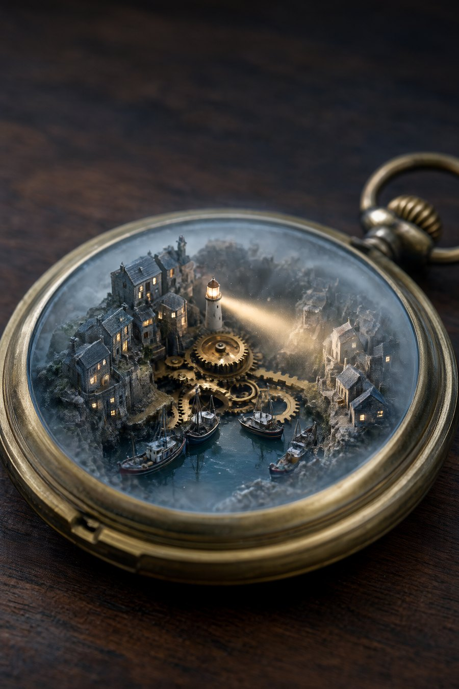

**Prompt**

```text
A macro photograph of an antique brass pocket watch lying open on a dark walnut table. Inside the open watch, where the clockwork should be, sits a tiny foggy harbor town at night: miniature stone houses with warm lit windows climb the brass gears like cliffs, small fishing boats rest in a pool of real water, and a tiny lighthouse on the central gear sweeps a warm beam of light across the mist and the watch face. Shallow depth of field, the rim of the watch soft in the foreground, fine dust and haze catching the beam. Cool blue-grey fog and dark wood with the warm amber lighthouse beam as the single accent. Vertical composition, the watch filling the lower two thirds. Ultra HD, 4K, miniature photography.
```

**Recipe**

- **Model:** Qwen-Image 2.1
- **LoRA:** Qwen-Image-2.1-viggle-turbo-v0.2.1-6step-lora-r256.safetensors (strength 1)
- **Steps:** 6
- **CFG:** 1
- **Sampler:** euler
- **Scheduler:** manual sigmas
- **Sigmas:** 1, 0.976538, 0.951036, 0.892753, 0.735083, 0.480498, 0
- **Guider:** BasicGuider
- **Size:** 1344x2016
- **Seed:** 4302
- **Weights:** qwen_image_2.1_int8_convrot.safetensors
- **Text encoder:** qwen3vl_8b_int8_convrot.safetensors
- **VAE:** qwen_image_2.1_vae_bf16.safetensors

**Why it works:** "Macro photograph, shallow depth of field" makes a tiny harbor read as a real object on a table. The amber lighthouse beam is the one warm note in the fog.

## 06. Sunset on the Floating Isle

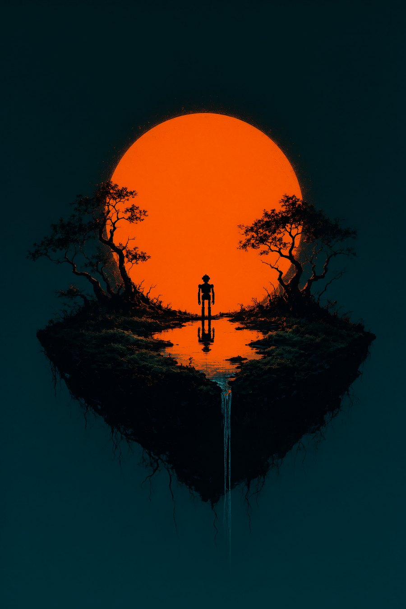

**Prompt**

```text
A flat, high-contrast graphic illustration in the style of a two-colour screenprint, with fine grain. A small lone robot stands at the edge of a floating island of dark moss and twisted trees, silhouetted in black. Behind it, a huge burning-orange sun fills the centre of the sky as a perfect disc. The island hangs above a deep teal void, with roots trailing below it and a thin waterfall falling from its edge into nothing. The sun rims the robot and the tree branches in orange and lays a long reflection across a small pool on the island. Palette of deep teal, black and one burning orange. One bold disc, one small silhouette, clean empty space.
```

**Recipe**

- **Model:** Qwen-Image 2.1
- **Steps:** 25
- **CFG:** 1
- **Sampler:** euler
- **Scheduler:** simple
- **Size:** 1344x2016
- **Seed:** 7121
- **Weights:** qwen_image_2.1_int8_convrot.safetensors
- **Text encoder:** qwen3vl_8b_int8_convrot.safetensors
- **VAE:** qwen_image_2.1_vae_bf16.safetensors

**Why it works:** Three colours and no more: deep teal, black, one burning orange. The layout is named as shapes, one disc and one silhouette, so it still reads as a thumbnail.

## 07. The Sleeping Giants

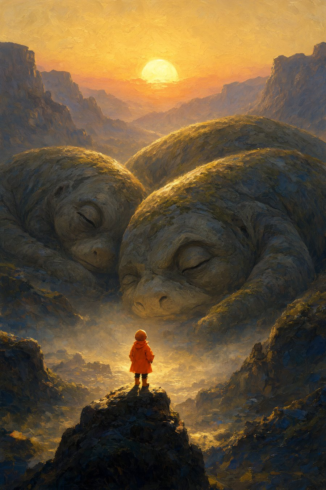

**Prompt**

```text
A painterly matte painting at golden dusk, with visible brushwork. Two colossal creatures lie sleeping in a wide canyon, so vast that their backs are mountains, their skin like weathered stone with moss in the folds; each has one great closed eye. Behind them, a low sun sets in a sky of glowing amber and rose haze, and its warm light rims the giants' backs and fills the canyon with golden mist. In the lower third, a tiny child in a bright orange raincoat stands on a boulder in the light, looking up at them, a small silhouette against the bright mist. Palette of glowing amber sky, deep blue-grey shadow on the giants, and the orange raincoat. Extreme scale contrast, the giants filling two thirds of the frame.
```

**Recipe**

- **Model:** Qwen-Image 2.1
- **Steps:** 25
- **CFG:** 1
- **Sampler:** euler
- **Scheduler:** simple
- **Size:** 1344x2016
- **Seed:** 8051
- **Weights:** qwen_image_2.1_int8_convrot.safetensors
- **Text encoder:** qwen3vl_8b_int8_convrot.safetensors
- **VAE:** qwen_image_2.1_vae_bf16.safetensors

**Why it works:** The light has a source and a job. A low sun rims the giants and fills the canyon with mist, and the child's orange raincoat is where your eye lands.

## 08. The Tree in the Sea

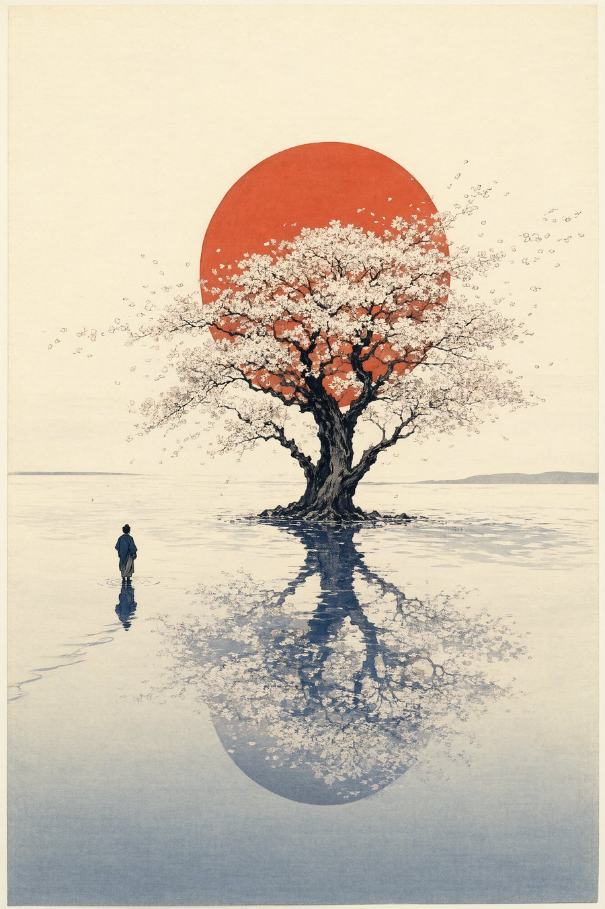

**Prompt**

```text
A traditional Japanese woodblock print on cream washi paper, with visible wood grain in the flat colour areas and slight colour misregistration at the edges. A mirror-still ocean at dusk stretches to a low horizon. Out on the water stands one single enormous blossoming tree, rooted in the sea itself, its dark twisting trunk and wide crown filling the upper half of the frame. Directly behind the crown sits a huge vermilion sun disc, low on the horizon, and the tree's black silhouette cuts across it. Pale petals drift from the crown across the sky in a long diagonal. The whole tree and sun are mirrored perfectly in the still water below. One small figure in a dark robe stands on the water in the lower left third, facing the tree, with one thin line of ripples running from their feet toward the reflection. Palette of indigo, cream paper and soft grey, with the vermilion sun as the only saturated colour. Wide empty sky and calm negative space.
```

**Recipe**

- **Model:** Qwen-Image 2.1
- **Steps:** 25
- **CFG:** 1
- **Sampler:** euler
- **Scheduler:** simple
- **Size:** 1344x2016
- **Seed:** 9436
- **Weights:** qwen_image_2.1_int8_convrot.safetensors
- **Text encoder:** qwen3vl_8b_int8_convrot.safetensors
- **VAE:** qwen_image_2.1_vae_bf16.safetensors

**Why it works:** Medium and paper come first (a woodblock print on cream washi). The only saturated colour, a vermilion sun, sits right behind the crown, so the focal point is settled before anything else.

## 09. The Crane and the Crescent

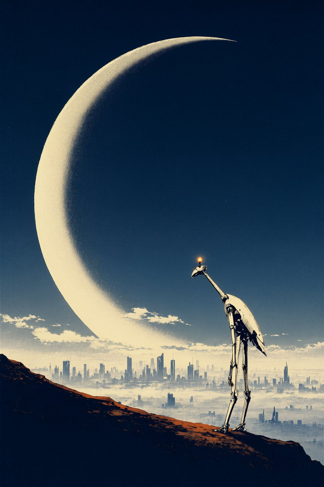

**Prompt**

```text
A three-colour screenprint poster in navy, cream and burnt orange, with visible halftone dots, paper grain and slight ink misregistration. At dusk, an immense crescent-shaped megastructure arcs across the sky like a second moon, filling the upper half of the frame, its inner edge glowing cream and lighting the low clouds beneath it. Far below, a futuristic city lies half-drowned in fog, its towers pale silhouettes fading into the haze. In the foreground, on a dark rocky outcrop at the lower right, stands one tall, thin, white crane-like robot on two long legs, its long neck bent toward the city, its body edged with cream light from the arc. A single small burnt-orange signal lamp glows on its head, the only orange in the whole image. The outcrop's edge runs from the lower left corner up toward the robot as a diagonal. Flat bold shapes, wide empty sky, strong silhouette.
```

**Recipe**

- **Model:** Qwen-Image 2.1
- **Steps:** 25
- **CFG:** 1
- **Sampler:** euler
- **Scheduler:** simple
- **Size:** 1344x2016
- **Seed:** 9461
- **Weights:** qwen_image_2.1_int8_convrot.safetensors
- **Text encoder:** qwen3vl_8b_int8_convrot.safetensors
- **VAE:** qwen_image_2.1_vae_bf16.safetensors

**Why it works:** Naming the print process and its three inks keeps the whole image flat and graphic. The huge crescent gives the tall, thin robot one bold shape to stand against.

## 10. The Chalk Giant

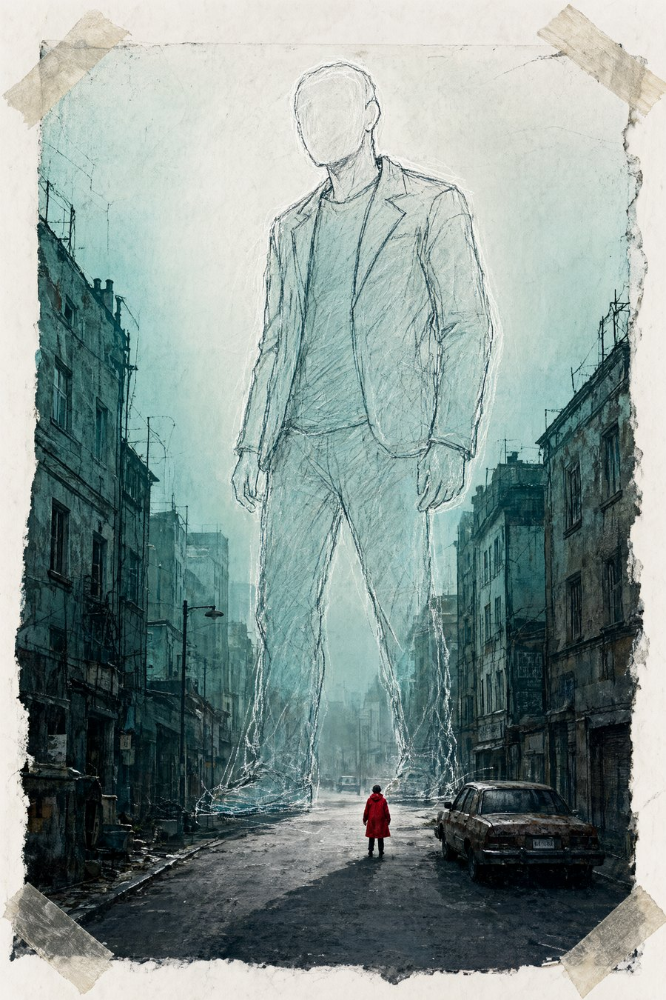

**Prompt**

```text
A mixed-media collage on heavy paper: a faded black-and-white photograph of an empty, overgrown city street with rusted cars, overprinted in a single teal ink, torn at the edges and held down with strips of old masking tape. Drawn over the photograph in loose white chalk and black ink lines is a giant faceless figure striding between the buildings, three times taller than the rooftops, its sketchy outline filling two-thirds of the frame. Pale fog glows behind the figure, and the chalk lines catch that light. In the street below, in the lower third, one tiny real person in a vivid red raincoat stands in the photograph, looking up at the drawing. The street runs from the lower left corner toward the giant's feet as a strong diagonal. Palette of teal, paper white and ink black, with the red raincoat as the only saturated colour. Visible paper fibres, pencil smudges and tape texture over the whole image.
```

**Recipe**

- **Model:** Qwen-Image 2.1
- **Steps:** 25
- **CFG:** 1
- **Sampler:** euler
- **Scheduler:** simple
- **Size:** 1344x2016
- **Seed:** 9476
- **Weights:** qwen_image_2.1_int8_convrot.safetensors
- **Text encoder:** qwen3vl_8b_int8_convrot.safetensors
- **VAE:** qwen_image_2.1_vae_bf16.safetensors

**Why it works:** Two layers, described separately: an old teal photograph underneath, a chalk drawing on top. The model keeps both textures, and the red raincoat is the one warm accent.

## 11. The Face in the Dunes

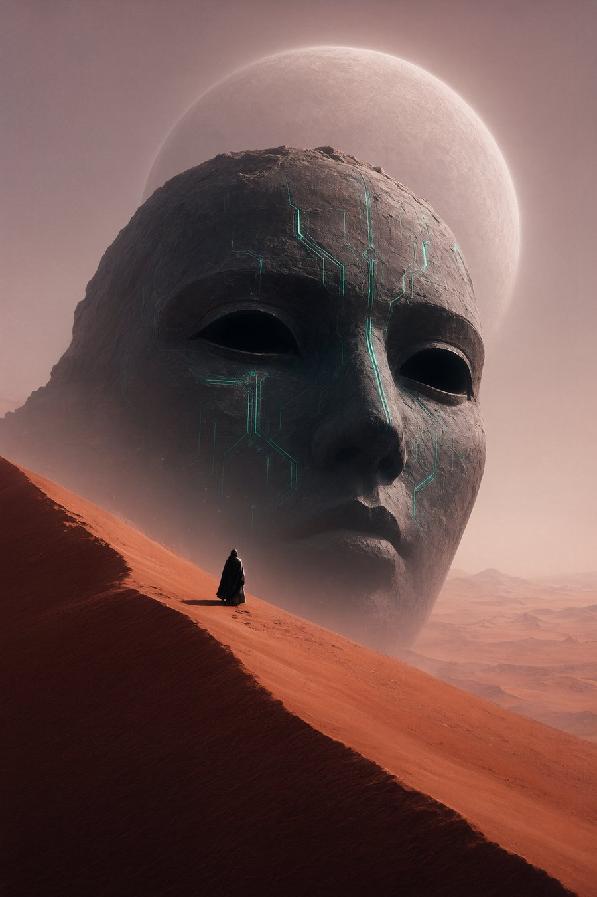

**Prompt**

```text
A large-format matte painting printed on fine canvas, with soft film grain and faint canvas weave over the whole image. A colossal stone face rises out of a desert of rust-red dunes, only its brow, eyes and cheekbones above the sand, filling the upper two-thirds of the frame. Thin circuit lines carved into the dark stone glow a vivid teal, and the two empty eye sockets are deep black voids. Behind the head hangs a huge pale planet, its disc wider than the face, and its cold light floods the dusty haze so the whole sky glows a soft rose-grey. A long dune ridge runs from the lower left corner up toward the face as a strong diagonal. On that ridge, in the lower third, one small figure in a dark cloak stands with its back to the viewer, looking up, a thin rim of planet-light along its shoulders. Palette of deep black, dusty rust-red and rose-grey haze, with the teal glow of the carved circuits as the only saturated colour. Enormous scale contrast and a wide empty sky.
```

**Recipe**

- **Model:** Qwen-Image 2.1
- **Steps:** 25
- **CFG:** 1
- **Sampler:** euler
- **Scheduler:** simple
- **Size:** 1344x2016
- **Seed:** 9411
- **Weights:** qwen_image_2.1_int8_convrot.safetensors
- **Text encoder:** qwen3vl_8b_int8_convrot.safetensors
- **VAE:** qwen_image_2.1_vae_bf16.safetensors

**Why it works:** Scale in plain terms: the face fills the upper two-thirds, one small figure stands in the lower third. Teal is saved for the carved circuits alone.

## 12. The Beacon

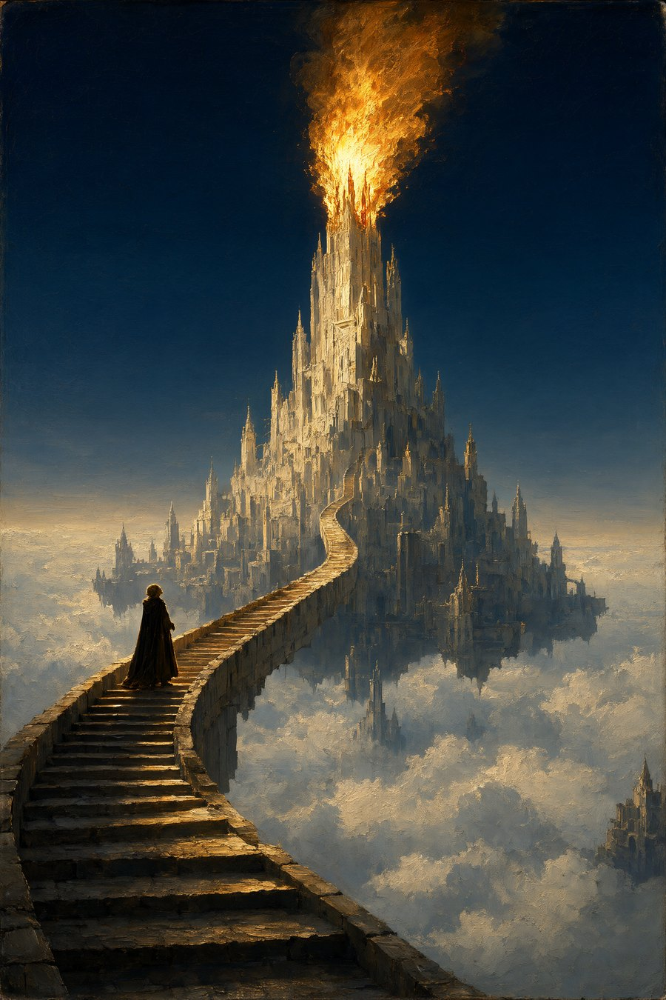

**Prompt**

```text
A romantic-era oil painting on canvas, with thick impasto in the flames and fine craquelure over the whole surface. At night, a floating city of pale stone towers drifts above a sea of clouds. From its tallest central spire a huge pyre of golden fire erupts upward, the only light in the scene: its glow floods the clouds below in a wide warm pool about a third of the frame across and throws long shadows off every tower. A long curving stone stair climbs from the lower left corner up toward the spire as a strong diagonal. Halfway up the stair, one small cloaked figure pauses and looks up at the fire, edged in gold light. Above, the night sky is deep blue and empty. Palette of deep blue night, pale stone and warm grey cloud, with the golden fire as the only saturated colour. Grand scale and quiet awe.
```

**Recipe**

- **Model:** Qwen-Image 2.1
- **Steps:** 25
- **CFG:** 1
- **Sampler:** euler
- **Scheduler:** simple
- **Size:** 1344x2016
- **Seed:** 9485
- **Weights:** qwen_image_2.1_int8_convrot.safetensors
- **Text encoder:** qwen3vl_8b_int8_convrot.safetensors
- **VAE:** qwen_image_2.1_vae_bf16.safetensors

**Why it works:** One fire is the light source, and the prompt says what it lights: the clouds below, long shadows off every tower. A stone stair from the lower-left corner leads the eye up to it.
